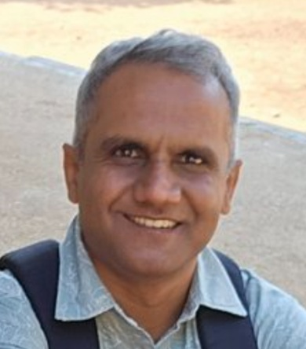
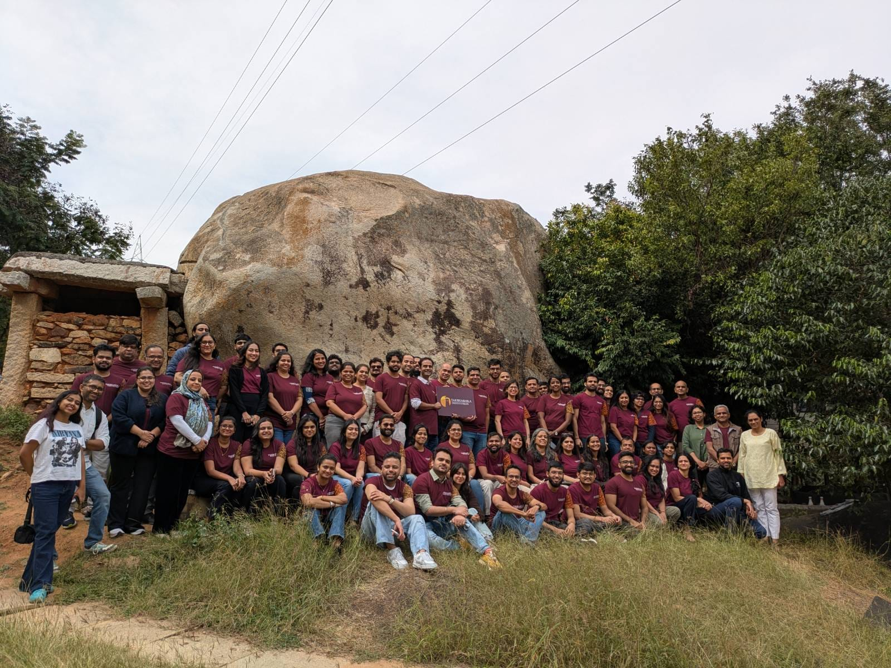

Hello! I am Sandeep Ramdurg. I have served in private companies for 20+ years as an 
embedded software engineer/architect in R&D of cellular protocol software (3G/4G/5G technologies).
While building software, I have also contributed in project management and business development 
roles for the product(s) that we built.

<!--
- Education
    - 1997: B.E., Electronics & Communication,
            Mysore University, India.
    - 2001: M.S., Electrical Communication Engineering,
            Indian Institute of Science, India.
- Core experience (Upto 2020)
    - 2001-2006: Senior Engineer - Sasken Communication Technologies India Pvt. Ltd.
    - 2006-2008: Senior Engineer - Motorola India Pvt. Ltd.
    - 2008-2012: Technical Lead/Manager - Smartplay Technologies India Pvt. Ltd.
    - 2012-2014: Software Architect - Signalchip Innovations India Pvt. Ltd.
    - 2015-2017: Technology Architect - Synapse Design India Pvt. Ltd.
    - 2017-2020: Senior Solution Architect - Sasken Technologies India Pvt. Ltd.
-->

- More Info in my linkedin profile: [linkedin](https://www.linkedin.com/in/sandeep-ramdurg/)

Since 2020, I have moved on to work as a freelance independent consultant. 
I aspire to continue contributing in my core area as a consultant. I also aspire to 
contribute in new areas of environment, social, and governance impact through 
my writings and projects. This web page captures my 2nd career as a consultant 
since 2025.

## Interests

**Core**:-
    Create artifacts like trainings, tools, reference designs etc. based on prior experience 
    to enable teams to design and develop wireless telecom stacks;
    Provide support to businesses for project, people, product and services management;
    Provide consulting to analyse and predict trends in wireless telecom landscape;
    Perform research to create content (paper, ideas, opinion, policy etc.);

**Environment/Societal**:-
    Analyse and report environmental, social and governance (ESG) problems prevalent in India;
    Propose, plan and execute ESG projects for corporates as part of CSR initiatives;
    Analyse or propose public policy in the areas of technology and ESG;
    Participate in social and political movements for empowerments of the economically and socially weak communities;

Following memberships, certifications, publications and projects have been pursued in freelance mode. 

## Memberships
- **07.2022**:- [Fellow, Institute of Electronics & Telecommunication Engineers (IETE), India](./assets_temp/memberships/iete.png), Membership No. F-503318

## Certifications
- **01.2026**:- [Graduate Certificate in Public Policy (Advanced Public Policy)](./assets_temp/certifications/gcpp.png), Takshashila Institute, Bengaluru

*GCPP Batch42 workshop group photo, Dec06 2025*

- **03.2027 (planned)**:- IICA Certified CSR Professional (ICP-CSR), Indian Institute of Corporate Affairs (IICA), New Delhi
- **03.2027 (planned)**:- IICA Certified ESG Professional (ICP-ESG), Indian Institute of Corporate Affairs (IICA), New Delhi

## Literary Works

- [Recommendations for Policy on “Prevention & Regulation of Online Gaming”](./assets_temp/publications/online_gaming.pdf);
    Policy Analysis, Submitted to Takshashila Institute as final project work for award of degree;
    01.01.2026

- [Ramping up adoption of Public Internet in India](./assets_temp/publications/public-wifi.pdf);
    Opinion Piece, Submitted to Takshashila Institute as public engagement exercise for award of degree;
    28.12.2025

- [Relieving India's Language Stress](./assets_temp/publications/language_policy.pdf);
    Policy Proposal, Submitted to Takshashila Institute as public engagement exercise for award of degree;
    22.12.2025

Earlier Works (prior 2025):

- [Reasons for environmental non-compliances in urban areas](./assets_temp/publications/2024_02_02_mohua_appeal_PAPER-FINAL.pdf);
    Policy Proposal, Submitted to the Urban Development Department, Government of Karnataka, 
    as a grievance and proposal;
    07.02.2024

- [Policy for roll out PMWANI public wifi in India](./assets_temp/publications/policy_v1.0.pdf); 
    Policy Paper, Prepared for internal use by company for roll out of PMWANI public wifi; 
    31.10.2022

## Project Works

**04.2025 to Present:- Self-engaged to build service offerings in core and social areas of work** \
*(Working on acquiring certifications, Learning/refreshing old and new engineering subjects, Practising developing protocol code)*
